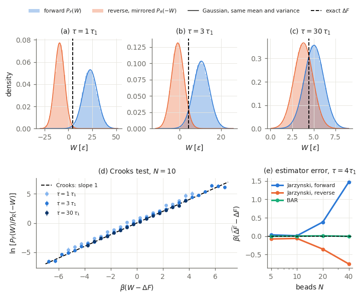

# Jarzynski & Crooks theorems for a pulled 2D polymer

A two-dimensional bead–spring chain is anchored at one end and stretched by a harmonic trap moving
through a Langevin heat bath. From 10⁵ pulls per condition we measure the work distribution, estimate
the free-energy difference ΔF with the Jarzynski equality, Crooks theorem and Bennett's acceptance ratio,
and compare every estimate with an **exact** reference.



## Documents
| file | content |
|---|---|
| [`docs/paper.pdf`](docs/paper.pdf) | paper-style write-up: model, methods, results, discussion |
| [`docs/report.pdf`](docs/report.pdf) | detailed report with all tables, numerical checks and diagnostics |
| [`docs/theory.pdf`](docs/theory.pdf) | theory companion: Langevin bath, three proofs of Jarzynski, Crooks, derivation of every estimator, numerical scheme |
| `animations/` | A1: one chain pulled slowly vs fast; A2: work histogram and running Jarzynski estimate |

## Main results
- **Validation:** for the Gaussian chain the simulated work statistics match the exact theory of the
  discrete algorithm; the scheme satisfies Jarzynski to O(Δt²) (8×10⁻⁴ k_BT at Δt = 0.01).
- **One control parameter:** the dissipated work follows βW_diss ≈ (π²/6) N/(τ/τ₁) (affine stretching,
  within ~12% for N ≥ 10). At fixed τ/τ₁ the work distributions at different temperatures collapse.
- **Exponential cost in chain length:** with 10⁵ pulls, one-sided Jarzynski is exact up to N = 10 and
  off by +1.47 k_BT at N = 40; bootstrap error bars are 2–3× over-confident.
- **Where the average comes from:** plots of e^(−βW) show the exponential average is carried by pulls
  typical of the *reverse* process, which the forward sample never reaches for fast pulls or long chains.
- **Crooks and BAR:** log-ratio slopes 0.98–0.99 (theory: 1); Bennett's acceptance ratio recovers
  ΔF = 19.694 at N = 40 as 19.688 ± 0.039.

## Layout
```
src/jarz/
  params.py        Chain dataclass, <u^2>, Rouse matrix, tau_1
  model.py         energy and forces (torch, shape (M, N, 2))
  sampling.py      exact equilibrium sampling (tilted rejection on the trap weight)
  dynamics.py      BAOAB Langevin integrator with work bookkeeping (switch / relax)
  reference.py     exact Delta F: closed form (b=0), log-space radial convolution (b>0)
  linear_exact.py  exact <W>, Var W of the discrete algorithm for b=0
  estimators.py    Jarzynski (fwd/rev), BAR, Crooks log-ratio, 2nd cumulant, ESS, bootstrap, blocks
tests/             pytest suite (20 tests)
scripts/
  s00_reference.py   exact Delta F for all sweep points (cached in data/reference)
  s01_validation.py  Gaussian chain vs exact theory
  s02_speed.py       pulling time
  s03_temperature.py temperature sweep
  s04_size.py        bead-number sweep
  s05_animations.py  animations
  s06_checks.py      time-step halving / seed scatter
  s07_crooks.py      reverse pulls, Crooks test, BAR vs one-sided Jarzynski
data/              summary JSON files and exact reference curves
```

## Reproduce
Requires Python 3.12 with numpy, scipy, matplotlib, torch (CUDA optional) and pytest.
```
python -m pytest -q tests
cd scripts
python s00_reference.py && python s01_validation.py
python s07_crooks.py   # forward + reverse runs; the e^(-bW) rows of s02/s04 need the reverse runs
python s02_speed.py && python s03_temperature.py && python s04_size.py
python s05_animations.py && python s06_checks.py
cd ../docs && latexmk -pdf paper.tex report.tex theory.tex
```
The raw work samples (`data/runs/`, ~30 MB) are not in the repository; they are regenerated and cached
by the scripts. On an RTX 2060 the full set of runs takes about an hour.
